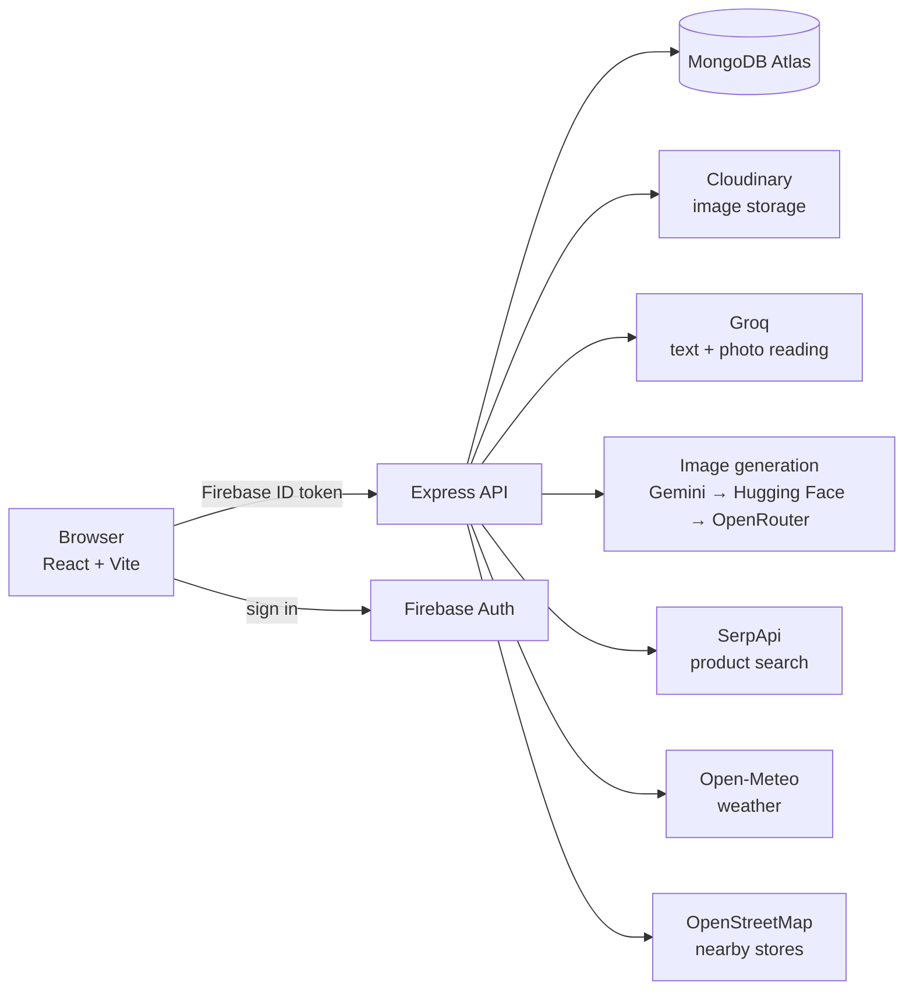

# DigiCloset

**Your AI stylist, built around the clothes you already own.**

[](https://react.dev/)
[](https://vite.dev/)
[](https://nodejs.org/)
[](https://expressjs.com/)
[](https://www.mongodb.com/atlas)
[](https://firebase.google.com/)
[](https://console.groq.com/)
[](https://opensource.org/licenses/ISC)

**Live demo:** [digi-closet-iota.vercel.app](https://digi-closet-iota.vercel.app) · **API:** [digi-closet-1.onrender.com](https://digi-closet-1.onrender.com/api/health)

DigiCloset turns your wardrobe into a digital closet. Add photos of your clothes once, and it plans outfits, reviews your looks, shows you wearing new pieces and helps you shop only for what you're actually missing.

---

## Contents

- [The problem](#the-problem)
- [Features](#features)
- [How it works](#how-it-works)
- [Tech stack](#tech-stack)
- [Getting started](#getting-started)
- [Environment variables](#environment-variables)
- [Scripts](#scripts)
- [Deployment](#deployment)
- [Project layout](#project-layout)
- [Troubleshooting](#troubleshooting)
- [Security and privacy](#security-and-privacy)
- [Roadmap](#roadmap)
- [Contributing](#contributing)
- [License](#license)

---

## The problem

Many people have a full wardrobe and still feel they have nothing to wear. Clothes get forgotten at the back of the closet, colours that don't suit them get bought, and online orders get returned because they looked different in person.

Most fashion apps don't help: they ignore what you already own and push new purchases. DigiCloset starts from **your real wardrobe**, your style profile, your colouring and the weather where you are.

---

## Features

### Your wardrobe
- **My Wardrobe**: upload a photo and AI fills in the category, colour, pattern and style for you.
- **Wardrobe Insights**: what you wear most, what you never wear and where the gaps are.
- **Saved Looks**: outfits, try-ons and products you liked, all in one place.
- **Overview dashboard**: today's weather, quick outfit ideas and style shortcuts.

### AI Studio
- **Outfit Generator**: complete outfits picked from your own clothes for any occasion.
- **Virtual Try-On**: see yourself in clothes from your wardrobe, or upload up to 5 photos of new clothes. Each look gets a rating for look, colour and matching, with a tip.
- **Style Makeover**: get a new style suggestion and see it on you, with matching products to buy.
- **Fashion Critic**: upload an outfit photo for a score, markers on the photo showing what works and what to fix, a head-to-toe check (skin tone, colour, fit, footwear, accessories, grooming, pose, setting) and "try instead" alternatives.
- **Colour Palette**: from a face photo (and optionally a wrist photo) it finds your skin tone, undertone, best colours, colours to use less, best metals and colour combinations. Saved to your profile.
- **AI Stylist chat**: ask anything about fashion. It knows your wardrobe, profile, saved outfits and the weather.

### Discover and plan
- **Weather Looks**: outfit ideas for today's forecast.
- **Clothes Finder**: describe what you want in plain words and get real products from **Myntra, AJIO, Amazon, Flipkart and Nykaa Fashion**.
- **Budget Planner**: a shopping list that fills real wardrobe gaps within your budget.
- **Location Finds**: physical clothing stores, boutiques and ethnic-wear shops within 5 km, sorted by speciality (ethnic, bridal, formal, streetwear…), on a map with directions.
- **Outfit Calendar**: plan outfits by date and track what you've worn.

### Account
- Sign in with **email and password**, **Google** or **phone number (OTP)**.
- Guided onboarding to set up your style profile.
- Export your data or delete your account at any time from Settings.

---

## How it works



- **Text and photo reading** (chat, wardrobe tagging, Fashion Critic, Colour Palette, outfits, budget plans) runs on **Groq**. Text uses `openai/gpt-oss-120b` with `openai/gpt-oss-20b` as backup; anything with a photo uses the vision model `qwen/qwen3.8-27b`. Set `AI_PROVIDER=gemini` to use Google Gemini instead.
- **Image generation** (Virtual Try-On and Style Makeover) tries each provider in `IMAGE_GENERATION_PROVIDERS` in order and moves to the next only when one has no quota or is down:
  1. **Gemini** image models (needs billing on the Google Cloud project)
  2. **Hugging Face Spaces** (free, daily GPU limit): IDM-VTON for single-garment try-on, FLUX.1 Kontext for everything else
  3. **OpenRouter** (paid credits) as the last fallback
- A provider that reports no quota is skipped for an hour so users aren't kept waiting.
- The app never shows fake or placeholder results: if no provider can serve a request, it says so.

---

## Tech stack

| Layer | Technologies |
|-------|--------------|
| **Frontend** | React 19, Vite 8, React Router 7, Axios, Lucide icons, custom CSS |
| **Backend** | Node.js, Express 5, Mongoose |
| **Database** | MongoDB (Atlas in production) |
| **Authentication** | Firebase Authentication (Auth Emulator for local development) |
| **AI (text and vision)** | Groq (default) or Google Gemini |
| **AI (images)** | Gemini, Hugging Face Spaces, OpenRouter |
| **Storage** | Cloudinary (local `uploads/` folder in development) |
| **Integrations** | SerpApi Google Shopping, Open-Meteo weather, OpenStreetMap (Overpass, Nominatim, Leaflet map) |
| **Hosting** | Vercel (frontend), Render (backend) |
| **Tooling** | Nodemon, Oxlint, Node test runner |

---

## Getting started

### Prerequisites

- **Node.js** 18 or newer
- **MongoDB** 6 or newer running locally, or a MongoDB Atlas connection string
- **Java**, needed by the Firebase Auth Emulator
- **Firebase CLI**: `npm install -g firebase-tools`
- A **Groq API key** from [console.groq.com/keys](https://console.groq.com/keys) (free)

### 1. Clone and install

```bash
git clone https://github.com/iam-Jam24/Digi_Closet.git
cd Digi_Closet

cd backend && npm install && cd ..
cd frontend && npm install && cd ..
```

### 2. Set up environment files

```bash
cp backend/.env.example backend/.env
cp frontend/.env.example frontend/.env
```

Locally, the defaults use the Firebase Auth Emulator and local storage, so the only value you need is `GROQ_API_KEY` in `backend/.env`. Everything else is optional (see below).

> **Never commit your `.env` files.** They are already in `.gitignore`.

### 3. Run the app

Open four terminal tabs:

```bash
# 1. Database
cd backend && npm run db:start

# 2. Local sign-in emulator
cd backend && npm run auth:start

# 3. API server (http://localhost:5001)
cd backend && npm run dev

# 4. Web app (http://localhost:5173)
cd frontend && npm run dev
```

Open **http://localhost:5173** and create an account. Check **http://localhost:5001/api/health** to see which AI provider, image providers and product search are active.

A longer walkthrough is in [`docs/setup-guide.md`](docs/setup-guide.md).

---

## Environment variables

Every setting is explained in [`backend/.env.example`](backend/.env.example) and [`frontend/.env.example`](frontend/.env.example). The main ones:

| Variable | Needed for | Required? |
|----------|-----------|-----------|
| `MONGODB_URI` | Database | Yes |
| `GROQ_API_KEY` | All AI text and photo features | Yes (with `AI_PROVIDER=groq`) |
| `AI_PROVIDER` | `groq` (default) or `gemini` | No |
| `GEMINI_API_KEY` | Gemini text (if chosen) and Gemini image generation | Optional |
| `HF_TOKEN` | Larger free Hugging Face GPU quota for try-on and makeover | Recommended |
| `OPENROUTER_API_KEY` | Paid fallback for try-on and makeover images | Optional |
| `IMAGE_GENERATION_PROVIDERS` | Order of image providers, e.g. `gemini,huggingface,openrouter` | No |
| `PRODUCT_SEARCH_API_KEY` | Live products in Clothes Finder and Style Makeover (SerpApi) | Optional |
| `CLOUDINARY_URL` | Image storage in production | Production only |
| `FIREBASE_PROJECT_ID`, `FIREBASE_CLIENT_EMAIL`, `FIREBASE_PRIVATE_KEY` | Firebase Admin in production | Production only |
| `CLIENT_URL` | Allowed frontend URL(s) for CORS | Production only |

The frontend needs `VITE_API_BASE_URL`, the `VITE_FIREBASE_*` web config and `VITE_USE_FIREBASE_EMULATOR` (see `frontend/.env.example`).

---

## Scripts

### Backend (`backend/`)

| Command | What it does |
|---------|--------------|
| `npm run dev` | Start the API with auto-reload |
| `npm start` | Start the API in production mode |
| `npm test` | Run the backend tests |
| `npm run db:start` / `db:stop` | Start or stop a local MongoDB |
| `npm run auth:start` | Start the Firebase Auth Emulator (accounts are kept between restarts) |
| `npm run auth:save` | Save the emulator's accounts right away |

### Frontend (`frontend/`)

| Command | What it does |
|---------|--------------|
| `npm run dev` | Start the development server |
| `npm run build` | Build for production |
| `npm run preview` | Preview the production build |
| `npm run lint` | Lint the code with Oxlint |

---

## Deployment

| Part | Host | Notes |
|------|------|-------|
| Frontend | **Vercel** | Root directory `frontend`, build `npm run build`, output `dist`. Set the `VITE_*` variables. |
| Backend | **Render** | Root directory `backend`, start `npm start`. Set the production variables above. |
| Database | **MongoDB Atlas** | Allow Render's outbound IPs (or `0.0.0.0/0`) in Network Access. |
| Auth | **Firebase** | Add the Vercel domain under Authentication → Settings → Authorized domains. |
| Images | **Cloudinary** | Required in production, because Render's disk is wiped on every deploy. |

After changing variables on Render, redeploy so the server picks them up.

---

## Project layout

```
Digi_Closet/
├── backend/
│   ├── src/
│   │   ├── config/        # env, database, Firebase Admin
│   │   ├── controllers/   # request handlers per feature
│   │   ├── middleware/    # auth, uploads, validation, rate limits, errors
│   │   ├── models/        # Mongoose models (User, ClothingItem, Look, ...)
│   │   ├── routes/        # API routes, mounted under /api
│   │   └── services/      # AI (Groq, Gemini), image providers, prompts, search, weather
│   └── test/              # Node test runner tests
├── frontend/
│   └── src/               # pages, components, hooks, layout, styles, utils
├── docs/                  # setup guide, API reference, project structure
└── firebase.json          # local emulator config
```

More detail: [`docs/api-reference.md`](docs/api-reference.md), [`docs/project-structure.md`](docs/project-structure.md), [`backend/README.md`](backend/README.md), [`frontend/README.md`](frontend/README.md).

---

## Troubleshooting

| Problem | Fix |
|---------|-----|
| Database connection refused | MongoDB isn't running. Run `npm run db:start` in `backend/`. |
| Sign-in fails with a network error | The Auth Emulator isn't running. Run `npm run auth:start` in `backend/`. |
| Pages don't load data | The API isn't running. Run `npm run dev` in `backend/`. |
| AI features say they aren't available | `GROQ_API_KEY` is missing or invalid. Fix it in `backend/.env` and restart the API. `/api/health` shows the active provider. |
| AI says "busy, try again in a minute" | Groq's free tier allows about 30 requests a minute per model. Wait a moment and try again. |
| Try-On or Makeover says image generation isn't available | Every image provider is out of quota. The API log says which. Add credit on OpenRouter, add an `HF_TOKEN` (or wait for the daily Hugging Face reset), or enable billing on your Gemini key. |
| Clothes Finder shows only store links | Live products need `PRODUCT_SEARCH_API_KEY` (a SerpApi key). |
| Phone sign-in code doesn't arrive locally | No real SMS is sent locally. The code is shown on the sign-in screen and in the emulator terminal. |

---

## Security and privacy

- Secrets live only in `.env` files and on the hosting dashboards, never in the repo.
- Every private request is checked with a Firebase ID token, and each user can reach only their own data.
- AI routes are rate-limited, and all inputs and uploads are validated.
- Fashion Critic and Colour Palette photos are analysed and not stored.
- Users can export or permanently delete their data at any time.

If you find a security issue, please report it privately to the maintainer instead of opening a public issue.

---

## Roadmap

- Mobile app with a daily outfit notification
- Price-drop alerts for saved products
- Cost-per-wear and sustainability insights
- Share looks with friends and let them vote

---

## Contributing

1. Fork the repo and create a branch, for example `feature/your-feature` or `fix/your-fix`.
2. Keep changes consistent with the existing code style.
3. Run `npm test` in `backend/` and `npm run lint` in `frontend/` before committing.
4. Use clear commit messages, for example `feat(wardrobe): add tag filter`.
5. Open a pull request against `main`.

---

## License

Released under the [ISC License](https://opensource.org/licenses/ISC).
